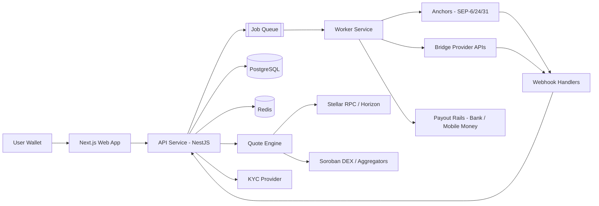

# LumenFlow

> **Swap. Bridge. Cash out.** One simple place to exchange tokens, move assets across blockchains, and convert crypto into real-world money, built on [Stellar](https://stellar.org).


---

## Table of Contents

1. [Overview](#overview)
2. [Why Stellar](#why-stellar)
3. [Features](#features)
4. [How It Works](#how-it-works)
5. [Architecture](#architecture)
6. [Tech Stack](#tech-stack)
7. [Monorepo Structure](#monorepo-structure)
8. [Getting Started](#getting-started)
9. [Environment Variables](#environment-variables)
10. [Running the Project](#running-the-project)
11. [Testing](#testing)
12. [Stellar Integration Details](#stellar-integration-details)
13. [Bridge Integration](#bridge-integration)
14. [Offramp and Compliance](#offramp-and-compliance)
15. [API Overview](#api-overview)
16. [Security](#security)
17. [Deployment](#deployment)
18. [Observability](#observability)
19. [Roadmap](#roadmap)
20. [Contributing](#contributing)
21. [FAQ](#faq)
22. [License](#license)
23. [Disclaimer](#disclaimer)

---

## Overview

**LumenFlow** is an easy-to-use platform that combines three things people usually need separate tools for:

| Capability | What it does |
|---|---|
| **Swaps** | Exchange one token for another quickly, at competitive rates, with a clean interface. |
| **Cross-chain bridges** | Move assets between blockchains through audited, third-party bridge providers. |
| **Crypto offramps** | Convert crypto (for example USDC) into local currency such as NGN and receive it in a bank account or mobile money wallet. |

The goal is speed, reliability, and a user experience that does not require users to be crypto experts. Freelancers paid in stablecoins, remote workers, traders, and small businesses should be able to hold value on-chain and turn it into spendable money in a few taps.

LumenFlow is **non-custodial by default**: users sign transactions in their own wallets, and the platform never holds their keys.

---

## Why Stellar

Stellar is purpose-built for moving value to and from real-world money.

- **Low fees and fast finality**: transactions settle in about five seconds at a very small cost.
- **Built-in DEX and liquidity pools**: swaps work at protocol level, without custom contracts.
- **Path payments**: a single transaction can route through several assets to find the best rate.
- **Anchors and SEPs**: standardized protocols (SEP-10, SEP-12, SEP-6, SEP-24, SEP-31) connect on-chain assets to local banking rails.
- **Native USDC**: widely used and well suited to stablecoin-based offramps.
- **Soroban smart contracts**: optional custom logic (fee splitting, escrow, routing) when needed.

---

## Features

### Swaps
- Asset-to-asset swaps using Stellar path payments, liquidity pools, and the order-book DEX
- Quote engine that compares routes and shows the best price, slippage, and fees before signing
- Optional aggregation of Soroban DEX liquidity
- Slippage controls and expiring quotes

### Bridging
- Provider-agnostic bridge interface (swap providers without touching the UI)
- Transfer status tracking from initiation to confirmation
- Fee and time estimates per route
- Automatic retry and stuck-transfer alerts

### Offramp
- SEP-24 hosted flows with partner anchors
- KYC through SEP-12 and a third-party identity provider
- Local payout rails for bank transfers and mobile money
- Rate lock during checkout, with clear fee breakdown

### Platform
- Multi-wallet support through Stellar Wallets Kit (Freighter, xBull, Albedo, Lobstr, and others)
- Automatic handling of trustlines and minimum XLM reserves for new users
- Mobile-first, responsive interface
- Transaction history with exportable receipts
- Admin dashboard for support, monitoring, and reconciliation

---

## How It Works

### Swap flow
1. The user connects a Stellar wallet.
2. They choose the asset to send and the asset to receive.
3. The quote engine returns the best route and expected output.
4. The backend builds an unsigned transaction (adding a trustline operation if needed).
5. The user signs in their wallet and the transaction is submitted to Stellar.
6. The app confirms the result and records it in the history.

### Bridge flow
1. The user selects source chain, destination chain, and asset.
2. The bridge adapter fetches a route quote from the chosen provider.
3. The user signs the source-chain transaction.
4. The worker polls the provider for status until the destination transfer completes.
5. The user is notified and the transfer is marked complete.

### Offramp flow
1. The user selects an asset and amount to cash out (for example USDC to NGN).
2. The app authenticates with the anchor using SEP-10.
3. If required, the user completes KYC (SEP-12).
4. The anchor's SEP-24 interactive flow collects bank or mobile money details.
5. The user signs a Stellar payment to the anchor.
6. The anchor confirms receipt and triggers the fiat payout.
7. Webhooks update the order status until funds are delivered.

---

## Architecture



### Design principles
- **Non-custodial first**: the backend builds transactions, the user signs them.
- **Adapter pattern**: bridge providers, anchors, KYC vendors, and payout rails sit behind interfaces so they can be swapped.
- **Idempotent, queue-driven processing**: every payout and bridge step can be retried safely.
- **Single source of truth**: PostgreSQL holds an append-only ledger of order state changes.
- **Fail visibly**: stuck or failed transfers raise alerts rather than silently waiting.

---

## Tech Stack

| Layer | Technology |
|---|---|
| Frontend | Next.js, React, TypeScript, Tailwind CSS, shadcn/ui, TanStack Query, Zustand |
| Wallets | Stellar Wallets Kit |
| Backend | Node.js, NestJS, TypeScript |
| Database | PostgreSQL (Prisma or Drizzle ORM) |
| Cache / Rate limiting | Redis |
| Queue | BullMQ (Redis) |
| Blockchain | Stellar JS SDK (`@stellar/stellar-sdk`), Stellar RPC, Horizon |
| Smart contracts (optional) | Soroban (Rust) |
| Bridging | Third-party bridge SDKs/APIs behind an adapter layer |
| Offramp | Stellar Anchor Platform or partner anchors (SEP-6/10/12/24/31) |
| KYC/AML | Provider such as Smile ID, Sumsub, or Onfido |
| Payouts | Local rails such as Paystack, Flutterwave, or direct bank integrations |
| Monorepo tooling | pnpm workspaces, Turborepo |
| Testing | Vitest/Jest, Playwright, Soroban test framework |
| Infrastructure | Docker, GitHub Actions, Terraform, AWS or GCP |
| Monitoring | Sentry, Prometheus, Grafana |

---

## Monorepo Structure

```
lumenflow/
├── apps/
│   ├── web/                  # Next.js frontend
│   ├── api/                  # NestJS REST API
│   └── worker/               # Queue consumers (payouts, bridge polling, webhooks)
├── packages/
│   ├── shared-types/         # Shared TypeScript types and Zod schemas
│   ├── stellar/              # Stellar SDK wrappers, path payment and trustline helpers
│   ├── bridge-adapters/      # Provider-agnostic bridge interface + implementations
│   ├── anchor-client/        # SEP-10/12/24 client helpers
│   ├── quote-engine/         # Route comparison and pricing logic
│   ├── ui/                   # Shared React components
│   └── config/               # Shared ESLint, TypeScript, and Prettier configs
├── contracts/                # Soroban smart contracts (Rust, optional)
├── infra/
│   ├── docker/               # Dockerfiles and compose files
│   └── terraform/            # Infrastructure as code
├── docs/                     # Architecture notes, runbooks, ADRs
├── scripts/                  # Dev and maintenance scripts
├── .github/workflows/        # CI/CD pipelines
├── turbo.json
├── pnpm-workspace.yaml
└── package.json
```

> **Note:** Any custody or key-signing service should live in a separate private repository with restricted access.

---

## Getting Started

### Prerequisites

- **Node.js** 20 LTS or newer
- **pnpm** 9 or newer (`npm install -g pnpm`)
- **Docker** and Docker Compose (for PostgreSQL and Redis)
- **Rust** and the Stellar CLI (only if working on Soroban contracts)
- A Stellar wallet such as [Freighter](https://www.freighter.app/) set to **Testnet**

### Installation

```bash
# 1. Clone the repository
git clone https://github.com/<your-org>/lumenflow.git
cd lumenflow

# 2. Install dependencies
pnpm install

# 3. Copy environment files
cp apps/web/.env.example apps/web/.env.local
cp apps/api/.env.example apps/api/.env
cp apps/worker/.env.example apps/worker/.env

# 4. Start local infrastructure (PostgreSQL + Redis)
docker compose -f infra/docker/docker-compose.dev.yml up -d

# 5. Run database migrations
pnpm --filter api db:migrate

# 6. (Optional) Seed test data
pnpm --filter api db:seed
```

### Funding a testnet account

Create a Stellar testnet keypair and fund it with Friendbot:

```bash
pnpm scripts:create-testnet-account
```

Or visit `https://friendbot.stellar.org/?addr=<YOUR_PUBLIC_KEY>`.

---

## Environment Variables

### `apps/web/.env.local`

| Variable | Description | Example |
|---|---|---|
| `NEXT_PUBLIC_API_URL` | Base URL of the API | `http://localhost:4000` |
| `NEXT_PUBLIC_STELLAR_NETWORK` | `TESTNET` or `PUBLIC` | `TESTNET` |
| `NEXT_PUBLIC_HORIZON_URL` | Horizon endpoint | `https://horizon-testnet.stellar.org` |
| `NEXT_PUBLIC_RPC_URL` | Stellar RPC endpoint | `https://soroban-testnet.stellar.org` |

### `apps/api/.env`

| Variable | Description |
|---|---|
| `NODE_ENV` | `development`, `staging`, or `production` |
| `PORT` | API port (default `4000`) |
| `DATABASE_URL` | PostgreSQL connection string |
| `REDIS_URL` | Redis connection string |
| `STELLAR_NETWORK_PASSPHRASE` | Network passphrase for the selected network |
| `STELLAR_HORIZON_URL` | Horizon endpoint |
| `STELLAR_RPC_URL` | Stellar RPC endpoint |
| `ANCHOR_HOME_DOMAIN` | Home domain of the anchor (for `stellar.toml` discovery) |
| `ANCHOR_SIGNING_KEY` | Public key used to verify anchor SEP-10 challenges |
| `SEP10_SERVER_SECRET` | Secret used for signing SEP-10 challenges (use a KMS in production) |
| `KYC_PROVIDER_API_KEY` | API key for the KYC provider |
| `PAYOUT_PROVIDER_API_KEY` | API key for the payout provider |
| `BRIDGE_PROVIDER_API_KEY` | API key for the bridge provider |
| `JWT_SECRET` | Secret for session tokens |
| `WEBHOOK_SIGNING_SECRET` | Secret used to verify incoming webhooks |
| `SENTRY_DSN` | Error tracking DSN (optional) |

### `apps/worker/.env`

Shares most values with the API: `DATABASE_URL`, `REDIS_URL`, the Stellar variables, and provider API keys.

> **Never commit `.env` files or secrets.** Use a secrets manager (AWS Secrets Manager, GCP Secret Manager, Doppler, or similar) in staging and production.

---

## Running the Project

```bash
# Run everything in development mode
pnpm dev

# Run individual apps
pnpm --filter web dev        # http://localhost:3000
pnpm --filter api dev        # http://localhost:4000
pnpm --filter worker dev

# Build all packages and apps
pnpm build

# Lint and type-check
pnpm lint
pnpm typecheck

# Format code
pnpm format
```

### Useful scripts

| Command | Purpose |
|---|---|
| `pnpm db:migrate` | Apply database migrations |
| `pnpm db:studio` | Open the database GUI |
| `pnpm scripts:create-testnet-account` | Generate and fund a testnet account |
| `pnpm contracts:build` | Build Soroban contracts |
| `pnpm contracts:test` | Test Soroban contracts |
| `pnpm openapi:generate` | Regenerate OpenAPI docs |

---

## Testing

```bash
# Unit tests across the monorepo
pnpm test

# Watch mode for a single package
pnpm --filter stellar test:watch

# End-to-end tests (requires the stack running)
pnpm test:e2e

# Soroban contract tests
cd contracts && cargo test
```

### Testing strategy
- **Unit tests** for the quote engine, Stellar helpers, and adapter logic.
- **Integration tests** against Stellar **Testnet**, with mocked bridge and payout providers.
- **End-to-end tests** (Playwright) for swap, bridge, and offramp user journeys.
- **Contract tests** for any Soroban code, plus fuzzing for critical logic.
- **Webhook replay tests** to confirm idempotent handling.

---

## Stellar Integration Details

### Swaps
- Uses `pathPaymentStrictSend` and `pathPaymentStrictReceive` operations to route across the order book and liquidity pools.
- Quotes are fetched by path-finding endpoints and cross-checked against aggregator liquidity where available.
- Transactions are built server-side, returned unsigned, and signed by the user's wallet.

### Accounts, trustlines, and reserves
- Every Stellar account must hold a minimum XLM reserve, and each non-native asset requires a trustline.
- The app detects missing trustlines and adds a `changeTrust` operation to the transaction when needed.
- The UI explains reserve requirements in plain language to new users.

### Soroban contracts (optional)
Contracts live in `/contracts` and are only introduced where native operations are insufficient (for example fee splitting or escrow). Each contract requires tests and an external audit before mainnet use.

### Network configuration
Switch networks through environment variables. Always develop on **Testnet** and verify behavior before touching **Mainnet**.

---

## Bridge Integration

LumenFlow does **not** build its own bridge. Bridges are among the most attacked components in crypto, so the platform integrates audited third-party providers instead.

All providers implement a common interface in `packages/bridge-adapters`:

```ts
export interface BridgeAdapter {
  name: string;
  getSupportedRoutes(): Promise<BridgeRoute[]>;
  getQuote(params: QuoteParams): Promise<BridgeQuote>;
  buildTransfer(quote: BridgeQuote, sender: string): Promise<UnsignedTransfer>;
  getStatus(transferId: string): Promise<TransferStatus>;
}
```

### Selecting providers
Evaluate each provider on:
- Supported chains and assets (including Stellar)
- Security track record and audit history
- Fees, speed, and liquidity depth
- API stability and support

> Provider support for Stellar changes quickly. Verify current coverage before enabling a route in production.

### Operational safeguards
- Per-route transfer limits and kill switches
- Provider health checks and automatic fallback
- Alerts for transfers pending beyond expected time

---

## Offramp and Compliance

### Anchor integration
- Discover anchors via their `stellar.toml`.
- Authenticate with **SEP-10**, collect customer information with **SEP-12**, and run deposit/withdrawal using **SEP-24** (or **SEP-6** for programmatic flows).
- Use **SEP-31** for cross-border payment partners where applicable.
- Either integrate existing anchors or operate your own with the [Stellar Anchor Platform](https://github.com/stellar/java-stellar-anchor-sdk).

### KYC/AML
- Tiered limits tied to verification level
- Sanctions and PEP screening
- Transaction monitoring and suspicious activity workflows
- Record retention aligned with applicable regulations

### Regulatory notes
Crypto-to-fiat services are regulated. Before operating in any jurisdiction (for example Nigeria), confirm current licensing and reporting requirements with qualified legal counsel and the relevant regulators. Operating through a licensed anchor or payout partner may reduce, but does not remove, your own obligations.

---

## API Overview

Interactive docs are available at `/docs` (Swagger/OpenAPI) when the API is running.

### Core endpoints (illustrative)

| Method | Endpoint | Description |
|---|---|---|
| `POST` | `/auth/challenge` | Request a wallet-signing challenge |
| `POST` | `/auth/verify` | Verify the signed challenge and issue a session |
| `GET` | `/assets` | List supported assets |
| `POST` | `/swap/quote` | Get a swap quote |
| `POST` | `/swap/build` | Build an unsigned swap transaction |
| `POST` | `/bridge/quote` | Get a bridge route quote |
| `POST` | `/bridge/transfer` | Initiate a bridge transfer |
| `GET` | `/bridge/transfer/:id` | Check bridge transfer status |
| `POST` | `/offramp/quote` | Get an offramp rate and fee breakdown |
| `POST` | `/offramp/orders` | Create an offramp order |
| `GET` | `/offramp/orders/:id` | Check offramp order status |
| `GET` | `/transactions` | List user transaction history |
| `POST` | `/webhooks/anchor` | Anchor status callbacks |
| `POST` | `/webhooks/bridge` | Bridge status callbacks |
| `POST` | `/webhooks/payout` | Payout status callbacks |

### Order states

```
CREATED → QUOTED → AWAITING_SIGNATURE → SUBMITTED → PROCESSING → COMPLETED
                                                  ↘ FAILED / EXPIRED / REFUNDED
```

---

## Security

Security is a core promise of this project, not an afterthought.

- **Non-custodial by default**: users keep control of their keys.
- **Key management**: any operated keys live in an HSM, cloud KMS, or MPC custody solution, never in environment files or source control.
- **Webhook verification**: all provider callbacks are signature-checked and processed idempotently.
- **Input validation**: Zod schemas validate every request and response boundary.
- **Rate limiting and abuse controls**: per-IP, per-account, and per-endpoint.
- **Authentication**: wallet-signature login (SEP-10 style), short-lived sessions, optional 2FA for sensitive actions.
- **Least privilege**: separate credentials and roles per service.
- **Dependency hygiene**: lockfiles, automated dependency updates, and vulnerability scanning in CI.
- **Audits**: independent audits for any smart contracts, and a penetration test before mainnet launch.
- **Incident readiness**: kill switches for routes and providers, documented runbooks, and alerting.

### Reporting vulnerabilities

Please **do not open public issues for security problems**. Email **security@your-domain.com** with details and reproduction steps. We aim to acknowledge reports within 48 hours. A responsible disclosure policy and bug bounty may be added as the project matures.

---

## Deployment

### Environments
| Environment | Network | Purpose |
|---|---|---|
| Local | Stellar Testnet | Development |
| Staging | Stellar Testnet | QA and integration testing |
| Production | Stellar Mainnet (Public) | Live users |

### Pipeline
1. Pull request triggers lint, type-check, and tests (affected packages only).
2. Merge to `main` builds Docker images and deploys to staging.
3. Tagged releases are promoted to production after manual approval.
4. Database migrations run as a gated step before the new version goes live.

### Infrastructure
- Containerized services (ECS, Kubernetes, or a managed platform such as Railway or Render for early stages)
- Managed PostgreSQL and Redis with automated backups
- Infrastructure defined in Terraform under `/infra/terraform`

---

## Observability

- **Logging**: structured JSON logs with request and order correlation IDs
- **Metrics**: Prometheus and Grafana dashboards for quote latency, swap success rate, bridge completion time, and payout success rate
- **Error tracking**: Sentry across web, API, and worker
- **Alerts**: failed payouts, stuck bridge transfers, provider downtime, abnormal volume, and reconciliation mismatches
- **Reconciliation**: scheduled jobs compare internal records against on-chain data, anchor reports, and payout provider statements

---

## Roadmap

### Phase 1: MVP
- [ ] Monorepo setup, CI, and shared packages
- [ ] Wallet connection through Stellar Wallets Kit
- [ ] Swaps using native path payments
- [ ] Trustline and reserve handling
- [ ] One offramp corridor via a partner anchor (SEP-24) with KYC
- [ ] Transaction history

### Phase 2: Expansion
- [ ] First bridge provider integration with status tracking
- [ ] Soroban DEX/aggregator liquidity in the quote engine
- [ ] Additional payout rails and currencies
- [ ] Admin dashboard and reconciliation tooling
- [ ] Push and email notifications

### Phase 3: Scale
- [ ] Multiple bridge providers with automatic best-route selection
- [ ] Mobile app (React Native)
- [ ] Business accounts and API access for merchants
- [ ] Recurring offramps and payout scheduling
- [ ] Custom Soroban contracts where justified, with audits

### Ideas under consideration
- Fiat onramp (local currency to stablecoin)
- Payment links and invoicing
- Multi-language support

---

## Contributing

Contributions are welcome.

1. **Fork** the repository and create a branch: `git checkout -b feat/your-feature`
2. **Make your changes** following the conventions below.
3. **Run checks**: `pnpm lint && pnpm typecheck && pnpm test`
4. **Commit** using [Conventional Commits](https://www.conventionalcommits.org/) (`feat:`, `fix:`, `docs:`, `chore:`).
5. **Open a pull request** describing what changed and why, linking any related issue.

### Conventions
- TypeScript strict mode; avoid `any`
- Shared logic belongs in `/packages`, not duplicated across apps
- New providers must implement the relevant adapter interface and include tests
- Add or update documentation for user-facing or architectural changes
- Never commit secrets, private keys, or real user data

### Good first issues
Look for issues labeled `good first issue` or `help wanted`.

---

## FAQ

**Is LumenFlow custodial?**
No. Users sign transactions with their own wallets. The platform builds transactions and coordinates flows but does not hold user keys.

**Which blockchains can I bridge to and from?**
It depends on the connected bridge providers and their current Stellar support. The supported route list is fetched from providers at runtime.

**Which countries and currencies are supported for offramp?**
It depends on partner anchors and payout rails. The initial focus is Nigeria (NGN), with more corridors planned.

**Do I need to write Soroban contracts?**
Not for the MVP. Native Stellar operations cover swaps and payments. Contracts are added only when custom logic is needed.

**Can I run this on Mainnet today?**
Not until the security review, compliance setup, and provider agreements are complete. Use Testnet for all development.

---

## License

This project is licensed under the **MIT License**. See the [LICENSE](./LICENSE) file for details.


---

<p align="center">Built with care on <a href="https://stellar.org">Stellar</a>.</p>