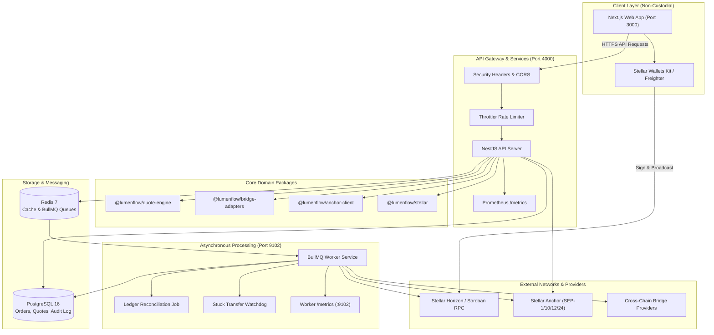
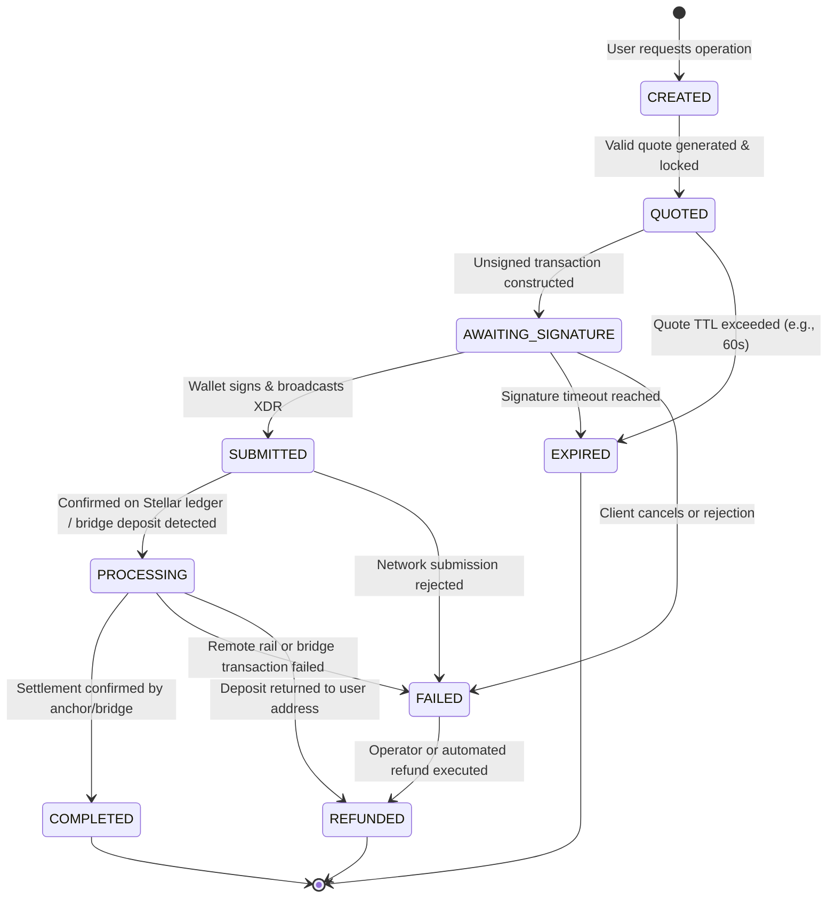

# LumenFlow System Architecture

> **Version**: Testnet v0.1.0  
> **Status**: Testnet Implementation  
> **Architecture Principle**: Strictly Non-Custodial, Append-Only Auditing, Resilient Asynchronous Worker Settlement.

---

## 1. System Overview

LumenFlow is an open-source, non-custodial liquidity and settlement gateway connecting Stellar with external blockchains (e.g. Ethereum, Polygon, Avalanche) and traditional fiat rails (via Stellar SEP-24 / SEP-31 anchor protocols and local payout adapters).

### Core Architectural Principles
1. **Zero Custody of User Funds**: LumenFlow servers and workers **never hold, see, or store user private keys**. All transactions (Stellar Horizon XDRs, Soroban contracts, or EVM bridge interactions) are built unsigned on the server and signed exclusively by client wallets (e.g., Freighter, Albedo, MetaMask).
2. **Deterministic State Machine**: Orders progress through strict, unidirectional finite-state transitions tracked in an append-only event log (`OrderEvent`).
3. **Decoupled Background Workers**: Real-time HTTP requests remain fast and responsive. Heavy operations (bridge polling, anchor status reconciliation, stuck-transfer alarms) are handled asynchronously via BullMQ on Redis.
4. **Defense in Depth**: API-level rate limiting, strict CORS, CSP security headers, HMAC-signed webhooks, and administrative safeguard kill-switches.

---

## 2. System Topology



---

## 3. Monorepo Structure

```
lumenflow/
├── apps/
│   ├── api/             # NestJS API application (Port 4000)
│   ├── web/             # Next.js 16 Web frontend (Port 3000)
│   └── worker/          # BullMQ background worker (Metrics Port 9102)
├── packages/
│   ├── anchor-client/   # SEP-1, SEP-10, SEP-12, SEP-24 client & mock anchor
│   ├── bridge-adapters/ # Cross-chain bridge abstraction, mock adapter & registry
│   ├── config/          # Shared ESLint, Prettier, and TypeScript configs
│   ├── quote-engine/    # Multi-hop routing and pathfinding on Stellar
│   ├── shared-types/    # Domain interfaces, enums, and Zod schemas
│   ├── stellar/         # Horizon SDK wrappers, keypair utilities, and helpers
│   └── ui/              # Shared Tailwind / React component library
├── infra/
│   ├── docker/          # Docker Compose dev environment (Postgres, Redis)
│   └── monitoring/      # Prometheus alerting rules & Grafana dashboards
├── scripts/             # One-command bootstrap and development scripts
└── docs/                # Architecture, runbooks, guides, and threat models
```

---

## 4. Order State Machine

Every swap, bridge, or offramp transfer is governed by a finite state machine enforced by `OrderStateMachineService`:



### Append-Only Event Log (`OrderEvent`)
Whenever a state transition occurs:
1. An update is made to the `Order` record within a database transaction.
2. A corresponding immutable `OrderEvent` is written containing `fromStatus`, `toStatus`, `reason`, `metadata`, and timestamp.
3. If an invalid transition is attempted (e.g. `COMPLETED` -> `PROCESSING`), an `OrderTransitionError` is thrown, rolling back the database transaction.

---

## 5. Non-Custodial Boundaries & Data Flows

### A. Swap Data Flow
1. **Quote Request**: The client requests a quote for converting `XLM` to `USDC`.
2. **Path Finding**: `@lumenflow/quote-engine` evaluates order books and liquidity pools on Stellar Horizon.
3. **Transaction Build**: `apps/api` builds an unsigned Stellar `PathPaymentStrictSend` or `PathPaymentStrictReceive` XDR.
4. **Client Signing**: The web app passes the XDR to Freighter or Albedo. The user inspects and signs locally.
5. **Submission**: The client submits the signed XDR directly to Stellar Horizon.

### B. Cross-Chain Bridge Data Flow
1. **Route Resolution**: `BridgeAdapterRegistry` checks active providers, evaluates kill-switches, and computes fees and minimum amounts.
2. **Deposit Info**: The adapter generates a unique non-custodial deposit address or Stellar memo for the target chain.
3. **Worker Monitoring**: `apps/worker` monitors the bridge provider API / Horizon transactions until destination chain confirmation.
4. **Webhooks / Polling**: Providers push HMAC-signed status updates or workers poll status with exponential backoff.

### C. SEP-24 Fiat Offramp Data Flow
1. **SEP-1 & SEP-10 Auth**: Client authenticates with the Anchor via cryptographic challenge-response (SEP-10 JWT).
2. **Interactive Withdraw**: Anchor provides an interactive URL for entering banking/mobile-money recipient information.
3. **User Transfer**: The Anchor provides a deposit Stellar account and memo. The user transfers funds from their wallet.
4. **Settlement**: Anchor disburses local fiat currency and issues webhook confirmation.

---

## 6. Observability & Safeguards

- **Prometheus Metrics**:
  - API metrics on `:4000/metrics`: HTTP duration, quote latency, swap/bridge/offramp counters.
  - Worker metrics on `:9102/metrics`: BullMQ queue depth, stuck transfers count, reconciliation mismatches.
- **Sentry Integration**: Exception tracking enabled automatically in production environments (`SENTRY_DSN`).
- **Emergency Safeguards**:
  - Administrative kill-switch endpoints (`POST /bridge/safeguards/kill-switch`) require `x-admin-key`.
  - Max per-transfer volume caps (`POST /bridge/safeguards/limits`) prevent bridge route drainage during market anomalies.
